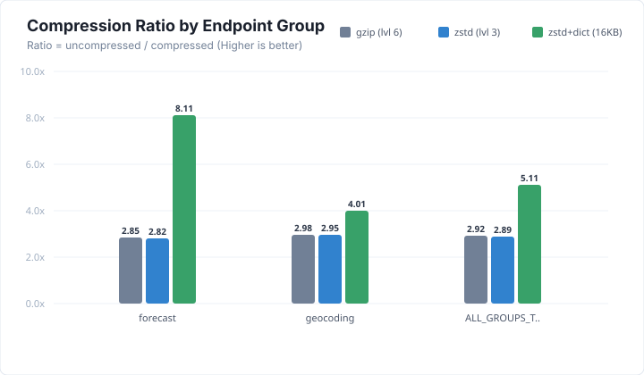
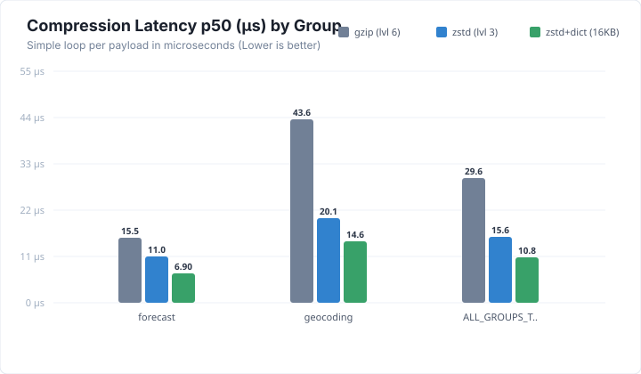
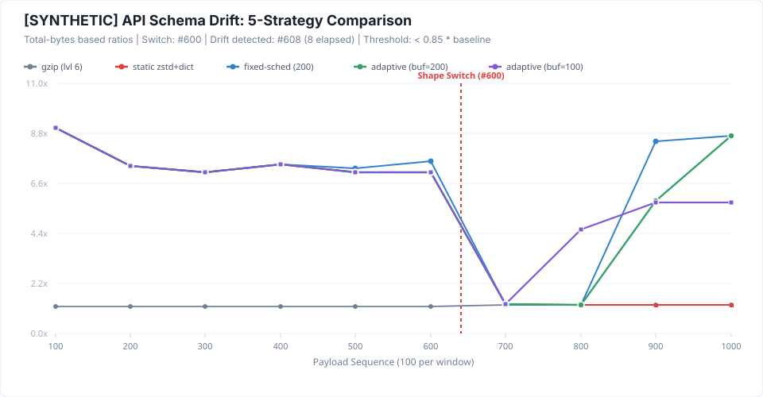

# zdict

Self-learning zstd dictionary compression for JSON APIs (JVM library).

**Work in progress.**

## How Learning Works

zdict automatically learns endpoint-specific zstd dictionaries directly from live HTTP traffic without manual intervention:

1. **Endpoint Grouping**: Requests are grouped by Spring MVC's best-matching handler pattern (e.g. `/api/products/{id}` via `HandlerMapping.BEST_MATCHING_PATTERN_ATTRIBUTE`), avoiding high-cardinality path explosions.
2. **PII Scrubbing**: Before payloads are sampled, `PayloadScrubber` parses JSON trees with Jackson and replaces denylisted keys (`password`, `token`, `secret`, `email`, `phone`, `card`, `ssn`, etc.) with `"x"`. It also applies regex scrubbing to mask emails, JWT-like three-segment tokens, and 9+ digit runs. Non-JSON payloads are discarded and never stored.
3. **Reservoir Sampling**: `SampleStore` performs bounded reservoir sampling (Algorithm R) per endpoint group both in memory and persisted under `zdict.data-dir/samples/<group-slug>/`. Only responses eligible for compression (status 200, JSON, no auth/cookies, not reflected) are sampled. Sampling runs safely after response delivery and never affects request processing.
4. **Holdout Evaluation & Canary Registration**:
   - `DictionaryTrainerService.train(group)` requires at least `zdict.train.min-samples` (default 200).
   - Samples are split 80/20 into training and holdout sets.
   - A candidate dictionary (16 KB) is trained on the 80% split using `ZstdDictTrainer`.
   - Compression ratios are measured across the 20% holdout set against plain zstd and against the currently ACTIVE dictionary (if one exists).
   - If no ACTIVE dictionary exists, the candidate goes directly to `ACTIVE` (`PROMOTED_FIRST_ACTIVE`).
   - If an ACTIVE dictionary already exists and candidate beats it by >= 5% on holdout, the candidate is registered as `CANARY` (`CANARY_STARTED`). If improvement < 5%, it is discarded.
5. **Drift Detection & Auto-Retraining**:
   - A rolling circular window (last 500 responses per group/dict) tracks `original size / compressed size` and failure counts in `RatioTracker`.
   - Baseline ratio is recorded at training time from holdout evaluation.
   - A group is `DRIFTING` when its `ACTIVE` dictionary has >= `zdict.drift.min-responses` (default 200) in the window AND rolling mean ratio < `baseline * (1 - zdict.drift.threshold)` (default 0.15).
   - The scheduled job runs every `zdict.auto-learning.interval` (default 60s):
     - No active dictionary + enough samples: trains initial dictionary and promotes to `ACTIVE`.
     - `DRIFTING`: clears that group's sample reservoir once (so old-shape payloads do not pollute retraining), continues serving the old active dictionary, and retrains as soon as `min-samples` fresh samples accumulate.
     - Enforces cooldown: at most one training per group per `zdict.train.cooldown` (default 15m).
6. **Canary Slicing & Autonomous Evaluation**:
   - Slicing: If the client advertises the canary ID, it is served canary compression for `zdict.canary.percent` of requests (default 5%, randomly selected per request). If the client lacks the canary ID, roughly the same percent of requests send `X-Dict-Available: <canaryId>` so clients fetch it. Clients never receive a canary encoding unless they advertised its ID.
   - Promotion: Once the canary has >= `zdict.canary.min-responses` (default 300) responses, it is compared against active:
     - `PROMOTE`: if canary mean ratio >= active mean ratio * 1.03 and canary failure rate <= active failure rate. Canary becomes `ACTIVE`; old active becomes `RETIRED`.
     - `ROLLBACK`: otherwise, canary is retired with reason string. Active dictionary remains unchanged.
     - `TIMEOUT`: if `zdict.canary.max-duration` (default 30m) elapses without enough traffic, canary rolls back with reason `"insufficient traffic"`.
   - Up to 3 versions per group are retained on disk and in memory (`ACTIVE`, `CANARY`, `RETIRED`).
7. **Client Negotiation Protocol**:
   - Clients send `X-Dict-Ids`: a comma-separated list of dictionary IDs they hold.
   - If the server has an `ACTIVE` dictionary for that group and its ID is in `X-Dict-Ids`, it compresses with it and sets `Content-Encoding: zstd-dict`, `X-Dict-Id: <id>`, `Vary: X-Dict-Ids, Accept-Encoding`.
   - If the client lacks the active dictionary, the server sends uncompressed data along with hint header `X-Dict-Available: <id>`.
   - `ZdictClient` caches dictionaries, sends `X-Dict-Ids`, fetches advertised dictionaries via `GET /zdict/dictionary/{id}`, and falls back to plain JSON upon any error.

## Configuration Keys

| Property | Default | Description |
|---|---|---|
| `zdict.enabled` | `false` | Enable or disable zdict compression |
| `zdict.paths` | `[]` | Allowlist of path prefixes eligible for dictionary compression and sampling |
| `zdict.data-dir` | `zdict-data` | Directory where samples and versioned dictionaries are persisted |
| `zdict.seed-dictionary-path` | `""` | Optional seed dictionary file path to initialize active dictionary at startup |
| `zdict.sample.rate` | `0.05` | Sampling probability for compression-eligible responses (5% default) |
| `zdict.sample.per-group-max` | `2000` | Maximum number of samples kept per endpoint group reservoir |
| `zdict.train.min-samples` | `200` | Minimum sample count required to train a dictionary for an endpoint group |
| `zdict.train.dict-size` | `16384` | Target dictionary size in bytes (16 KB default) |
| `zdict.train.cooldown` | `15m` | Minimum duration between training attempts for the same endpoint group |
| `zdict.drift.threshold` | `0.15` | Drop percentage from baseline ratio triggering drift detection (15% default) |
| `zdict.drift.min-responses` | `200` | Minimum rolling responses required before drift evaluation begins |
| `zdict.canary.percent` | `5` | Percentage of eligible traffic routed to CANARY dictionary |
| `zdict.canary.min-responses` | `300` | Minimum canary responses required before promotion evaluation |
| `zdict.canary.max-duration` | `30m` | Maximum lifetime of a canary dictionary before rollback on insufficient traffic |
| `zdict.auto-learning.enabled` | `false` | Enable scheduled autonomous training, drift remediation, and canary rollouts |
| `zdict.auto-learning.interval` | `60s` | Frequency of scheduled background auto-learning and canary checks |
| `zdict.dashboard.enabled` | `false` | Enable web dashboard at `/zdict/dashboard` (returns 404 when disabled) |
| `zdict.allow-authenticated` | `false` | When false, skips compression and sampling for requests with auth/cookies |
| `zdict.skip-reflected-input` | `true` | When true, skips compression if query params (length >= 4) reflect in body |
| `zdict.denylisted-fields` | standard PII keys | Set of field names whose values are replaced with `"x"` |

## Actuator, Dashboard & Security

> [!WARNING]
> **Security Notice**: Both the `/actuator/zdict/*` endpoints and `/zdict/dashboard` expose internal operational metrics, payload statistics, and manual trigger controls. They must **never be exposed publicly** to untrusted clients. Ensure reverse proxies or Spring Security restrict access to internal networks or authorized administrative roles.

- `GET /zdict/dashboard`: Live monitoring web dashboard (plain HTML + inline CSS + vanilla JS; supports system dark/light modes). Returns HTTP 404 when `zdict.dashboard.enabled: false`.
- `GET /actuator/zdict`: Returns current operational state: `{"enabled": true, "circuitOpen": false}`.
- `GET /actuator/zdict/groups`: Returns status per endpoint group (`HEALTHY | DRIFTING | CANARY | NO_DICTIONARY`), active/canary IDs, baseline ratio, rolling ratio, sample count, byte metrics (`bytesOriginal`, `bytesCompressed`, `bytesSaved`, `compressedResponses`), last trained time, and last event.
- `GET /actuator/zdict/events`: Returns the recent lifecycle events list.
- `POST /actuator/zdict`: Runtime kill switch toggle (`{"enabled": false}` to disable, `{"enabled": true}` to re-enable).
- `POST /actuator/zdict/train?group=...`: Triggers dictionary training for an endpoint group, returns holdout ratios and promotion decision.
- `GET /zdict/dictionary/{id}`: Serves raw dictionary bytes for any stored version (`ACTIVE`, `CANARY`, or `RETIRED`).

## Metrics (Micrometer / Actuator)

zdict exposes operational metrics via Micrometer and Spring Boot Actuator (`/actuator/metrics`):

| Metric Name | Type | Tags | Description |
|---|---|---|---|
| `zdict.ratio.rolling` | Gauge | `group` | Current rolling compression ratio (`original / compressed`) for active dictionary |
| `zdict.events` | Counter | `type`, `group` | Lifecycle events (`TRAINED`, `DRIFT_DETECTED`, `CANARY_STARTED`, `PROMOTED`, `ROLLED_BACK`) |
| `zdict.bytes.original` | Counter | `path` | Uncompressed response body size in bytes before compression |
| `zdict.bytes.compressed` | Counter | `path` | Compressed response body size in bytes sent over the wire |
| `zdict.responses` | Counter | `result`, `reason` | Total responses processed (`result = compressed \| skipped \| failed`, with skip/failure reason) |
| `zdict.compress.time` | Timer | - | Duration of zstd dictionary compression operations |
| `zdict.circuit.open` | Gauge | - | Circuit breaker state: `1.0` when open (compression suspended), `0.0` when closed |

### Skip & Failure Reasons

The `zdict.responses` counter includes the reason tag for visibility into gating decisions:
- `disabled`: Compression disabled by property or kill switch
- `circuit_open`: Circuit breaker open due to high failure rate or latency
- `unsupported_method`: HTTP method is not GET
- `authenticated_request`: Request contained `Authorization` or `Cookie` header (with `zdict.allow-authenticated=false`)
- `set_cookie_response`: Response set a cookie
- `private_cache_response`: Response marked `Cache-Control: private` or `no-store`
- `reflected_input`: BREACH protection triggered (query param >= 4 chars reflected in body)
- `no_dict_id` / `wrong_dict_id`: Client did not provide matching dictionary ID
- `non_json`: Content-Type is not `application/json`
- `size_out_of_bounds`: Body outside 200 B – 1 MB bounds
- `compression_error`: Native zstd compression failed (fail-open)

## Benchmarks

> [!IMPORTANT]
> **Data Authenticity Notice**: Benchmark results are only as meaningful as the input data. All numbers presented below are generated directly from reproducible test runs and are **never invented or rounded up**.
>
> - **Synthetic vs Real Data**: The results below were measured on **SYNTHETIC** datasets generated by `DriftBench --generate` (with payload schema changes labeled `_dataset: "SYNTHETIC"`). When benchmarking in production, use real browser HAR captures imported via `HarImporter`.
> - **Timing Methodology**: Per-payload latency measurements (p50 and p99 in microseconds) are collected via a simple measurement loop after JVM warmup passes, **not JMH microbenchmarks**. They reflect representative client-side/server-side CPU overhead for real payloads.

### 1. Compression Ratio Comparison



### 2. Compression Latency (p50 / p99)



### 3. Replay Benchmark Results (Synthetic Dataset)

- **Date**: `2026-10-20T06:22:02.0933411Z`
- **Environment**: Java `21.0.10`, Windows 11 `amd64`
- **Total Test Payloads**: 334 uncompressed JSON payloads (first 2/3 used for training, last 1/3 evaluated; strict time order, never shuffled, never tested on training data).
- **One-time Dictionary Size**: 16,384 bytes (16 KB) per group.

| Endpoint Group | Codec | Compressed Size | Ratio | Space Savings | p50 Latency | p99 Latency | Break-Even vs gzip |
|---|---|---|---|---|---|---|---|
| **products_v1** (200 payloads) | gzip (lvl 6) | 47,745 B | **1.21x** | 17.6% | 15.4 µs | 47.7 µs | - |
| | zstd (lvl 3) | 47,573 B | **1.22x** | 17.9% | 6.9 µs | 11.4 µs | - |
| | **zstd+dict (16 KB)** | **7,762 B** | **7.46x** | **86.6%** | **3.2 µs** | **6.3 µs** | **82 payloads** (199.9 B saved/req) |
| **products_v2** (134 payloads) | gzip (lvl 6) | 37,433 B | **1.28x** | 21.8% | 17.5 µs | 27.2 µs | - |
| | zstd (lvl 3) | 38,532 B | **1.24x** | 19.6% | 7.6 µs | 12.2 µs | - |
| | **zstd+dict (16 KB)** | **5,549 B** | **8.63x** | **88.4%** | **3.2 µs** | **8.4 µs** | **69 payloads** (237.9 B saved/req) |
| **All Groups Combined** | gzip (lvl 6) | 85,178 B | **1.24x** | 19.5% | 16.5 µs | 37.5 µs | - |
| | zstd (lvl 3) | 86,105 B | **1.23x** | 18.6% | 7.3 µs | 11.8 µs | - |
| | **zstd+dict (16 KB)** | **13,311 B** | **7.95x** | **87.4%** | **3.2 µs** | **7.4 µs** | **153 payloads** (215.2 B saved/req) |

#### Ratio by Payload Size Bucket

| Group | Size Bucket | Payload Count | gzip Ratio | zstd Ratio | zstd+dict Ratio |
|---|---|---|---|---|---|
| `products_v1` | < 1 KB | 200 | 1.21x | 1.22x | **7.46x** |
| `products_v2` | < 1 KB | 134 | 1.28x | 1.24x | **8.63x** |

---

### 4. Schema Drift Benchmark: 6-Strategy Comparison



> [!NOTE]
> - **SYNTHETIC Results**: All benchmark datasets in this section are **SYNTHETIC** (generated payloads labeled `_dataset: "SYNTHETIC"`). Compression ratios are **total-bytes based** ($\sum \text{uncompressed bytes} / \sum \text{compressed bytes}$), not arithmetic averages.
> - **Bench Retraining vs Production**: Bench retraining omits the holdout/canary check used in the production `demo-app` filter pipeline.
> - **Horizon Truncation**: Adaptive strategies cannot act on a schema shift when there are fewer than buffer-size payloads remaining in the traffic stream.

Simulates continuous traffic across 1,000 payloads: first 60% with Schema A (legacy schema), followed by 40% Schema B (renamed fields and nested structures).

- **Shape Switch Point**: Payload **#600**
- **Drift Detected At**: Payload **#608** (**8 payloads elapsed** after shape switch)
- **Dictionary Switch Points**: Adaptive-200: **#848** | Adaptive-100: **#748**
- **Evaluation Window**: 200 payloads | **Threshold**: `rolling mean < 0.85 * baseline`
- **Post-Drift Training**: Uses **ONLY** fresh post-drift payloads (buffer reset on detection)

#### Canonical 60/40 Stream Results (1,000 Payloads)

| Strategy | Total Compressed Size | Mean Ratio | Retrain Count | Post-Switch 100 Ratio | Training Time (ms) | Recovery Horizon |
|---|---|---|---|---|---|---|
| **gzip (level 6)** | 261,710 B | **1.26x** | 0 | 1.29x | 0 ms | - |
| **Static zstd+dict** | 146,904 B | **2.25x** | 0 | 1.33x | 174 ms | - |
| **Fixed-schedule (200/200)** | 104,306 B | **3.17x** | 4 | 1.30x | 308 ms | 200 payloads |
| **Fixed-schedule (100/100)** | 94,526 B | **3.50x** | 9 | 1.30x | 327 ms | 100 payloads |
| **Adaptive zdict (buffer=200)** | **112,463 B** | **2.94x** | **1** | **1.33x** | 205 ms | 240 payloads |
| **Adaptive zdict (buffer=100)** | **95,133 B** | **3.48x** | **1** | **1.33x** | 217 ms | 140 payloads |

#### Sensitivity Matrix: One Row Per (Strategy, Switch Point) Across 5 Seeds

Evaluated across 4 switch points (`550, 650, 730, 800`) and 5 random seeds (`42, 101, 2024, 777, 9999`) with real field value, size, and ordering variance. Means and min/max computed across seeds for each switch point:

| Strategy | Switch Point | Total Compressed Bytes (mean [min - max]) | Retrain Count (mean [min - max]) | Post-Switch 100 Ratio (mean [min - max]) | Training Time ms (mean [min - max]) |
|---|---|---|---|---|---|
| **gzip (level 6)** | #550 | 263,708 B [263,546 - 263,931] | 0.0 [0 - 0] | 1.29x [1.29x - 1.29x] | 0.0 ms [0 - 0] |
| **Static zstd+dict** | #550 | 159,869 B [158,528 - 162,221] | 0.0 [0 - 0] | 1.31x [1.30x - 1.33x] | 30.4 ms [25 - 38] |
| **Fixed-schedule (200/200)** | #550 | 115,646 B [114,945 - 117,147] | 4.0 [4 - 4] | 1.31x [1.30x - 1.31x] | 162.6 ms [125 - 192] |
| **Fixed-schedule (100/100)** | #550 | 85,545 B [85,092 - 85,946] | 9.0 [9 - 9] | 2.02x [1.99x - 2.05x] | 326.4 ms [252 - 407] |
| **Adaptive zdict (buffer=200)** | #550 | 114,027 B [112,585 - 117,756] | 1.0 [1 - 1] | 1.31x [1.30x - 1.33x] | 65.0 ms [49 - 76] |
| **Adaptive zdict (buffer=100)** | #550 | 97,333 B [96,253 - 101,049] | 2.0 [2 - 2] | 1.31x [1.30x - 1.33x] | 100.6 ms [87 - 108] |
| **gzip (level 6)** | #650 | 259,482 B [259,372 - 259,635] | 0.0 [0 - 0] | 1.29x [1.29x - 1.29x] | 0.0 ms [0 - 0] |
| **Static zstd+dict** | #650 | 137,957 B [136,413 - 141,460] | 0.0 [0 - 0] | 1.31x [1.30x - 1.33x] | 32.2 ms [23 - 37] |
| **Fixed-schedule (200/200)** | #650 | 93,831 B [93,327 - 95,490] | 4.0 [4 - 4] | 1.31x [1.29x - 1.32x] | 155.0 ms [122 - 181] |
| **Fixed-schedule (100/100)** | #650 | 84,438 B [84,026 - 84,687] | 9.0 [9 - 9] | 2.03x [1.99x - 2.05x] | 291.0 ms [225 - 352] |
| **Adaptive zdict (buffer=200)** | #650 | 113,469 B [112,032 - 118,460] | 1.0 [1 - 1] | 1.31x [1.30x - 1.33x] | 60.2 ms [46 - 72] |
| **Adaptive zdict (buffer=100)** | #650 | 94,992 B [93,322 - 100,382] | 1.0 [1 - 1] | 1.31x [1.30x - 1.33x] | 61.4 ms [47 - 84] |
| **gzip (level 6)** | #730 | 256,092 B [255,891 - 256,228] | 0.0 [0 - 0] | 1.29x [1.29x - 1.29x] | 0.0 ms [0 - 0] |
| **Static zstd+dict** | #730 | 120,446 B [118,734 - 124,932] | 0.0 [0 - 0] | 1.31x [1.29x - 1.34x] | 27.0 ms [17 - 39] |
| **Fixed-schedule (200/200)** | #730 | 77,028 B [76,295 - 78,605] | 4.0 [4 - 4] | 1.68x [1.67x - 1.69x] | 142.2 ms [87 - 210] |
| **Fixed-schedule (100/100)** | #730 | 87,612 B [87,352 - 87,796] | 9.0 [9 - 9] | 1.68x [1.66x - 1.70x] | 264.8 ms [171 - 374] |
| **Adaptive zdict (buffer=200)** | #730 | 113,337 B [111,553 - 118,711] | 1.0 [1 - 1] | 1.31x [1.29x - 1.34x] | 55.6 ms [34 - 82] |
| **Adaptive zdict (buffer=100)** | #730 | 93,705 B [91,586 - 99,382] | 1.0 [1 - 1] | 1.31x [1.29x - 1.34x] | 59.0 ms [33 - 81] |
| **gzip (level 6)** | #800 | 253,154 B [252,925 - 253,303] | 0.0 [0 - 0] | 1.29x [1.29x - 1.29x] | 0.0 ms [0 - 0] |
| **Static zstd+dict** | #800 | 105,116 B [103,232 - 110,484] | 0.0 [0 - 0] | 1.31x [1.30x - 1.33x] | 18.2 ms [17 - 20] |
| **Fixed-schedule (200/200)** | #800 | 103,809 B [103,135 - 105,582] | 4.0 [4 - 4] | 1.30x [1.30x - 1.31x] | 95.2 ms [88 - 99] |
| **Fixed-schedule (100/100)** | #800 | 92,896 B [92,350 - 93,167] | 9.0 [9 - 9] | 1.31x [1.30x - 1.33x] | 177.4 ms [171 - 186] |
| **Adaptive zdict (buffer=200)** | #800 | 105,116 B [103,232 - 110,484] | 0.0 [0 - 0] *(5/5 seeds 0 retrains)* | 1.31x [1.30x - 1.33x] | 18.2 ms [17 - 20] |
| **Adaptive zdict (buffer=100)** | #800 | 92,520 B [90,451 - 98,790] | 1.0 [1 - 1] | 1.31x [1.30x - 1.33x] | 36.2 ms [35 - 39] |

#### Missed-Drift & Horizon Truncation Analysis (Adaptive Runs with 0 Retrains)

When drift occurs late in a traffic stream (e.g., switch point #800), adaptive retraining buffers may not have enough remaining payloads to trigger before the stream ends:

| Strategy | Switch Point | Seed | Drift Detected At | Payloads Left After Detection | Buffer Needed | Horizon Diagnosis |
|---|---|---|---|---|---|---|
| **Adaptive zdict (buffer=200)** | #800 | 42 | #839 (39 elapsed) | **161 payloads** | 200 payloads | Detected at #839 (39 elapsed after switch #800), leaving 161 payloads in stream (< 200 needed for buffer). Retrain could not complete before stream end. |
| **Adaptive zdict (buffer=200)** | #800 | 101 | #841 (41 elapsed) | **159 payloads** | 200 payloads | Detected at #841 (41 elapsed after switch #800), leaving 159 payloads in stream (< 200 needed for buffer). Retrain could not complete before stream end. |
| **Adaptive zdict (buffer=200)** | #800 | 2024 | #840 (40 elapsed) | **160 payloads** | 200 payloads | Detected at #840 (40 elapsed after switch #800), leaving 160 payloads in stream (< 200 needed for buffer). Retrain could not complete before stream end. |
| **Adaptive zdict (buffer=200)** | #800 | 777 | #833 (33 elapsed) | **167 payloads** | 200 payloads | Detected at #833 (33 elapsed after switch #800), leaving 167 payloads in stream (< 200 needed for buffer). Retrain could not complete before stream end. |
| **Adaptive zdict (buffer=200)** | #800 | 9999 | #836 (36 elapsed) | **164 payloads** | 200 payloads | Detected at #836 (36 elapsed after switch #800), leaving 164 payloads in stream (< 200 needed for buffer). Retrain could not complete before stream end. |

*In contrast, **Adaptive zdict (buffer=100)** successfully retrained at #940 across seeds because 160+ remaining payloads is more than sufficient for its 100-payload buffer requirement.*

#### Gradual-Drift Stream Verification (400-Payload Transition: #300 -> #700)

Evaluates whether strategies can detect and recover from slow, progressive field migration rather than abrupt shape changes:

| Strategy | Detected Drift? | Detected At | Payloads Into Transition | Retrain Count | Total Bytes | Mean Ratio | Training Time (ms) |
|---|---|---|---|---|---|---|---|
| **gzip (level 6)** | No | - | - | 0 | 265,557 B | **1.27x** | 0 ms |
| **Static zstd+dict** | No | - | - | 0 | 155,617 B | **2.17x** | 32 ms |
| **Fixed-schedule (200/200)** | No (blind schedule) | - | - | 4 | 98,784 B | **3.42x** | 103 ms |
| **Fixed-schedule (100/100)** | No (blind schedule) | - | - | 9 | 91,141 B | **3.70x** | 175 ms |
| **Adaptive zdict (buffer=200)** | **Yes** | #475 | 175 payloads | 1 | 102,635 B | **3.29x** | 48 ms |
| **Adaptive zdict (buffer=100)** | **Yes** | #475 | 175 payloads | 2 | 112,777 B | **2.99x** | 69 ms |

#### Stationary Traffic Stream Verification (Numbers Only)

##### Clean No-Drift Stream (Shape A Only, 1,000 Payloads - Deterministic Single Run)

| Strategy | Total Compressed Size | Mean Ratio | Retrain Count | Training Time (ms) |
|---|---|---|---|---|
| **gzip (level 6)** | 244,680 B | **1.24x** | **0** | 0 ms |
| **Static zstd+dict** | 59,177 B | **5.13x** | **0** | 21 ms |
| **Fixed-schedule (200/200)** | 58,559 B | **5.19x** | **4** | 95 ms |
| **Fixed-schedule (100/100)** | 71,362 B | **4.26x** | **9** | 182 ms |
| **Adaptive zdict (buffer=200)** | 59,177 B | **5.13x** | **0** | 21 ms |
| **Adaptive zdict (buffer=100)** | 59,177 B | **5.13x** | **0** | 21 ms |

##### Noisy-Stationary Stream (Shape A Varying Sizes + Outliers, 1,000 Payloads)

| Strategy | Total Compressed Size | Mean Ratio | Retrain Count | False Alarm Count | Training Time (ms) |
|---|---|---|---|---|---|
| **gzip (level 6)** | 251,519 B | **1.62x** | **0** | **0** | 0 ms |
| **Static zstd+dict** | 64,330 B | **6.33x** | **0** | **0** | 18 ms |
| **Fixed-schedule (200/200)** | 51,752 B | **7.86x** | **4** | **0** | 84 ms |
| **Fixed-schedule (100/100)** | 63,736 B | **6.38x** | **9** | **0** | 153 ms |
| **Adaptive zdict (buffer=200)** | 64,330 B | **6.33x** | **0** | **0** | 18 ms |
| **Adaptive zdict (buffer=100)** | 64,330 B | **6.33x** | **0** | **0** | 18 ms |

#### Adaptive Variant Comparison: Buffer=100 vs Buffer=200

| Metric | Adaptive (buffer=200) | Adaptive (buffer=100) | Tradeoff Analysis |
|---|---|---|---|
| **Canonical Total Bytes** | 112,463 B | 95,133 B | **17,330 B saved** by buffer=100 due to earlier recovery |
| **Time-to-Recovery** | 240 payloads | 140 payloads | **100 payloads faster** recovery for buffer=100 |
| **Canonical Training Time** | 205 ms | 217 ms | Similar dictionary training overhead |
| **Switch Point 800 Horizon** | Fails to retrain before stream end (needs 200) | **Recovers at #940** | Buffer=100 safely handles late-stage drift without truncation |


---

### 5. How to Reproduce

All benchmark tools reside in `zdict-bench` and require only Java 17+ and Maven.

#### Step A: Import Real Browser HAR Captures
Convert a browser `.har` network export into structured, filesystem-safe payload directories grouped by endpoint pattern:
```bash
cd zdict-bench
mvn compile exec:java -D"exec.mainClass=dev.zdict.HarImporter" -D"exec.args=path/to/capture.har ../samples-dir"
```
*Filters HTTP 200 and `application/json`, normalizes numeric and UUID segments to `{id}`, validates JSON structure, and skips payloads > 1 MB.*

#### Step B: Run the Replay Benchmark
Replay collected samples in strict time order (first 2/3 train, last 1/3 test), verify round trips, and write results:
```bash
cd zdict-bench
mvn compile exec:java -D"exec.mainClass=dev.zdict.ReplayBench" -D"exec.args=../samples-dir ../benchmark-results"
```
*Outputs `benchmark-results/results.json`, `benchmark-results/results.md`, `benchmark-results/ratio.svg`, and `benchmark-results/latency.svg`.*

#### Step C: Run the Schema Drift Benchmark
Generate synthetic datasets and evaluate gzip vs static dictionary vs adaptive zdict:
```bash
cd zdict-bench

# 1. Generate synthetic Shape A (600 samples) and Shape B (400 samples):
mvn compile exec:java -D"exec.mainClass=dev.zdict.DriftBench" -D"exec.args=--generate ../benchmark-data/synthetic-A ../benchmark-data/synthetic-B 600 400"

# 2. Run drift benchmark:
mvn compile exec:java -D"exec.mainClass=dev.zdict.DriftBench" -D"exec.args=../benchmark-data/synthetic-A ../benchmark-data/synthetic-B ../benchmark-results"
```
*Outputs `benchmark-results/drift.svg` and `benchmark-results/drift.md`.*
